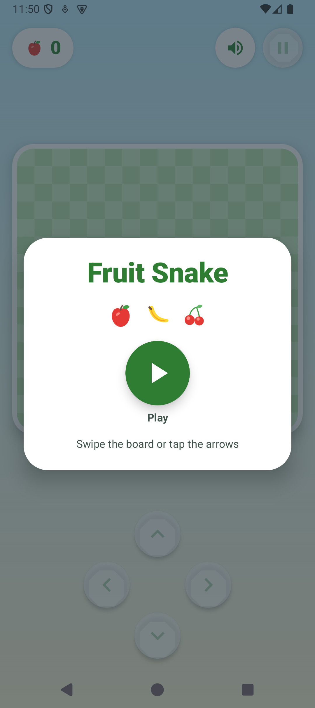

# Fruit Snake

A small offline snake game for kids. Eat apples, bananas, and cherries.
Big controls, a bright board, no internet, no ads, and no runtime
permissions.



## How to play

- Swipe the board or tap the arrow buttons to steer.
- Eat fruit to grow and score a point.
- Avoid the walls and your own tail.
- Tap pause any time. The game also pauses when the app goes to the
  background.
- Best score and sound preference are saved on the device.

## Build

Prerequisites: JDK 21, Android SDK, `adb`, and `just` on your `PATH`.

```bash
just build
```

Debug APK: `app/build/outputs/apk/debug/app-debug.apk`

## Install

```bash
just run
```

## Sounds

The two bundled effects live in `app/src/main/res/raw`. Regenerate them
with:

```bash
just sounds
```

## Offline and private

- No internet permission and no network access.
- No ads, analytics, accounts, or tracking.
- All art and audio are bundled in the APK.

## License

Licensed under either of

- MIT license ([LICENSE-MIT](LICENSE-MIT) or
  https://opensource.org/licenses/MIT)
- Apache License, Version 2.0 ([LICENSE-APACHE](LICENSE-APACHE) or
  https://www.apache.org/licenses/LICENSE-2.0)

at your option.
